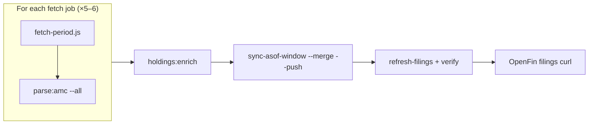
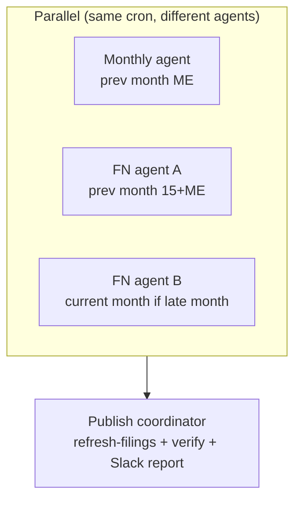

# Optimizing the daily `holdings:cloud` automation

This guide is based on the **2026-10-12** production trace (`cloud-holdings-report-1791815710487.json`, log at `/opt/cursor/artifacts/holdings-cloud-run.log`). Use it to shorten wall-clock time by **splitting work**, **skipping redundant steps**, and **attacking the real bottlenecks**—not by bypassing regression guards.

## What you are optimizing

`npm run holdings:cloud -- --push` (see `scripts/cloud-holdings-update.mjs`) runs **one long serial pipeline**:



**Calendar scope (daily):** previous + current UTC month → up to **6 jobs**: FN-15, FN month-end, monthly month-end for each month (monthly skipped when `period > today`).

**Defaults that affect time:**

| Setting | Cloud default | `fetch-period.js` default |
|--------|----------------|---------------------------|
| `FETCH_CONCURRENCY` | `4` | `10` |
| `FETCH_TIMEOUT_MS` | `180000` (3 min) | adapter-level |

Cloud uses **lower concurrency** on purpose (fewer false timeouts; see `CURSOR_CLOUD_HOLDINGS.md`).

---

## Trace summary (2026-10-12)

| Metric | Value |
|--------|------:|
| Report wall clock | **~64 min** (`13:31` → `14:35` UTC) |
| Fetch AMC-slots (sum over jobs) | 243 checked · 110 ok · 116 empty · 17 error |
| Files downloaded / rejected | 1,209 / 2,084 |
| New portfolio JSON pushed (fresh clone baseline) | 10,572 |
| `push_error` | `null` |

**Why it can feel like ~2 hours end-to-end**

- **~64 min** is in-pipeline time from the JSON report only.
- Add **environment setup** on a cold Cloud Agent: `npm ci`, venv + `pip install`, cloning `fund-holdings-data` into `.tmp/`, and `ensureFullPortfoliosAsOfCheckout()` materializing **all** `portfolios/asof/*` from git before sync.
- Add **agent scheduling / log polling** if you measure from cron trigger to “done” in the dashboard.

---

## Where the time goes (from log shape)

Log lines are a good proxy for CPU-heavy **parse** work; **fetch** time is mostly invisible in the log (few lines per AMC, but each AMC can block up to `FETCH_TIMEOUT_MS`).

| Phase | Log lines (approx.) | Est. share of 64 min |
|-------|--------------------:|---------------------:|
| **parse monthly 2026-09-30** | 21,390 | **~63% (~40 min)** |
| parse FN 2026-09-30 | 5,775 | ~11 min |
| parse FN 2026-09-15 | 4,363 | ~8 min |
| fetch (all jobs combined) | ~540 | **~15–25 min** (wall time; under-represented in logs) |
| parse FN Oct-15 / Oct-31 | ~580 each | ~1 min each |
| enrich + sync window + filings refresh + verify | ~670 | **~1–3 min** |

**Conclusion:** The dominant cost is **`parse:amc --all` for month-end monthly** (~846 files, ~51 AMCs, sequential AMC loop in `run_amc_parser.py`). Fetch is second (48–51 AMCs × several periods × slow hubs + 180s timeouts). **Sync/publish is not the problem** on this trace.

**Timeout hotspots (same log):** Unifi (180s ×2), Baroda BNP, Mirae, ICICI, HTML scrape 120s—each failed slot still burns full timeout budget.

---

## Optimization principles

1. **Do not** use `--allow-regression` or prune scripts to “go faster.”
2. **Prefer skipping work** over running the same full parse on a cold clone every day.
3. **Parallelize only where outputs are independent** (different as-of slices or AMC shards), then **one** enrich + filings refresh at the end.
4. **Keep monthly authoritative:** sync order in `sync-asof-window.mjs` (FN mid → FN month-end → monthly last) must be preserved for any publish job.

---

## Strategy A — Split automations (recommended)

Run **multiple Cloud Agents** on a schedule instead of one monolith. Each job uses the same secrets (`HOLDINGS_GH_TOKEN`, Union proxy, Cloudflare for Navi).

### A1. Cadence-based split (simplest ops)

| Automation | When (IST example) | Commands | Typical duration |
|------------|-------------------|----------|------------------|
| **Monthly publish** | Days 1–8 after month-end, 06:00 | fetch+parse **monthly** for prior month only → enrich → `sync-asof-holdings-to-github.mjs --asof=YYYY-MM-DD --cadence=monthly --push` → refresh filings | Heavy (~40+ min parse) |
| **Fortnightly publish** | Daily 06:30 | fetch+parse **FN-15 + FN month-end** for prev+current month → enrich → `holdings:sync-window` (FN slices only) or per-slice sync | Medium |
| **Filings-only guard** | After monthly job | `holdings:verify-filings` on data clone | Minutes |

**Skip October FN fetch on Oct 12:** trace showed **42–43 empty AMCs** and 1 file for Oct FN—running both Oct FN jobs daily adds ~2–4 min fetch + parse overhead for almost no CDN gain. Use a **calendar gate** in the automation prompt:

- If `today < month_end(current_month)` and day-of-month `< 18`, run **only** FN for **previous month** + monthly for **previous month** (if due), not current-month FN.

You can implement that today **without code changes** by calling `npm run fetch` / `parse:amc` explicitly instead of `holdings:cloud`.

### A2. Period-parallel split (max parallelism, 3 agents)

All agents share **no disk**; each clones parser + `.tmp/fund-holdings-data`. Each pushes **disjoint as-of slices** via merge sync (safe additive FN; monthly replaces only schemes present in parse).

| Agent | fetch + parse | Publish |
|-------|---------------|---------|
| **1** | `fortnightly` `2026-09-15`, `2026-09-30` | `--asof=2026-09-15 --cadence=fortnightly --push`, same for `2026-09-30` FN |
| **2** | `monthly` `2026-09-30` | `--asof=2026-09-30 --cadence=monthly --push` |
| **3** | `fortnightly` current-month FN slots (if not empty) | matching FN `--push` |

**Final agent (serial, after 1–3 succeed):**

```bash
export GH_TOKEN="$HOLDINGS_GH_TOKEN"
# clone/pull data repo to .tmp/fund-holdings-data
npm run holdings:refresh-filings -- --push
npm run holdings:verify-filings
```

**Caveat:** `holdings:enrich` reads **local** `data/parsed`. Parallel agents only enrich their own parse tree. For identifier consistency, either:

- run **enrich once** on a machine that has **all** disclosures parsed (merge parsed dirs or run full parse subset), **or**
- accept that enrich runs per-agent on partial trees before each slice sync (usually OK if mapping is per-scheme and slices do not overlap).

### A3. AMC-shard parse (one agent, multi-core)

`run_amc_parser.py --all` loops AMCs **sequentially**. On a larger VM, run **4 parallel shells** with disjoint `--amc=` lists (12 AMCs each), same `--type` / `--period`, then one enrich:

```bash
.venv/bin/python3 parsers/run_amc_parser.py --type=monthly --period=2026-09-30 --amc=sbi-mutual-fund,hdfc-mutual-fund,... &
# repeat for shards
wait
npm run holdings:enrich -- --allow-incomplete
```

**Expected speedup:** near-linear in shard count up to CPU/RAM (Excel parsing is heavy). This is the fastest **single-machine** win for the ~40 min monthly parse step.

---

## Strategy B — Reduce redundant work (no split)

### B1. Persistent data clone between runs

On a **custom environment snapshot** (see Cloud Agent environment builds):

- Keep `.tmp/fund-holdings-data` and `data/parsed` on disk across runs.
- `parse` resume (`filter_paths_for_resume` in `parse_progress.py`) skips unchanged workbooks **when outputs already exist**.

Cold clones re-parse everything—this alone can explain **2×** perceived runtime vs steady-state.

### B2. Smarter fetch

| Tactic | Effect |
|--------|--------|
| Raise `FETCH_CONCURRENCY` to **6** (not 8+) after monitoring | Shorter fetch wall time |
| Lower timeout for **known-empty** Oct FN jobs | Fail faster when hub is empty |
| Fix / isolate chronic timeouts (Unifi, ICICI, Mirae, Baroda) | Saves **3 min × occurrences** per run |
| Union/Navi: ensure proxy + Cloudflare secrets mapped every run | Avoid retry storms |

### B3. Skip `future_month_end` monthly (already in code)

`cloud-holdings-update.mjs` skips monthly fetch when `period > today`. Keep that—do not fetch October monthly until Oct 31.

### B4. Avoid full-tree checkout when not publishing

`ensureFullPortfoliosAsOfCheckout` runs whenever `.tmp/fund-holdings-data` is a git checkout—required before **filings refresh** so the index does not shrink. For **fetch+parse-only** jobs that push individual slices, you can defer full checkout to the **final filings agent** only.

---

## Strategy C — Product/code improvements (backlog)

These need small engineering changes but are the long-term fix:

1. **`holdings:cloud --jobs=monthly|fortnightly|sync-only`** — official subcommands instead of copy-pasted npm scripts.
2. **Parallel `--all` parse** — `ProcessPoolExecutor` in `run_amc_parser.py` with `--workers=N`.
3. **Incremental daily scope** — only re-fetch/re-parse AMCs with new disclosure files (compare probe hashes).
4. **Structured timing** — emit `data/probes/cloud-holdings-timing-*.json` with per-step `duration_ms` (today you must infer from logs).
5. **Separate automation repo checkout from data volume** — mount persistent volume for `.tmp/fund-holdings-data` in environment.json.

---

## Suggested target architecture



**Expected wall clock (user-visible):**

| Layout | Rough time |
|--------|------------|
| Current monolith | 60–90 min pipeline + setup |
| Monthly + FN parallel + coordinator | **~45 min** pipeline (limited by monthly parse shard) |
| Monthly parse 4-way shard + persistent clone | **~15–25 min** monthly leg |
| Skip early-month empty FN | **−5–10 min** on days 1–17 |

---

## Example: minimal split (copy-paste for automations)

**Job “holdings-monthly”** (run 1st–8th):

```bash
cd /workspace   # or cd pipeline in monorepo
export GH_TOKEN="$HOLDINGS_GH_TOKEN"
PREV=$(date -u -d "last month" +%Y-%m)
ME=$(date -u -d "${PREV}-01 +1 month -1 day" +%Y-%m-%d)
npm run fetch -- --type=monthly --period="$ME" --concurrency=4
npm run parse:amc -- --type=monthly --period="$ME" --all
npm run holdings:enrich -- --allow-incomplete
node scripts/sync-asof-holdings-to-github.mjs --asof="$ME" --cadence=monthly --push
```

**Job “holdings-fortnightly”** (daily):

```bash
# FN for prev+current month ends and 15ths — omit current FN when early month (prompt gate)
npm run holdings:sync-window -- --from=YYYY-MM --to=YYYY-MM --merge --push
```

**Job “holdings-filings”** (after others, or daily if only FN ran):

```bash
npm run holdings:refresh-filings -- --push
npm run holdings:verify-filings
```

---

## Monitoring

After each run, inspect:

- `data/probes/cloud-holdings-report-*.json` — `started_at` / `finished_at`, `fetch_totals`, `push_error`
- `data/probes/fetch-{type}-{period}.json` — per-AMC `error` / `empty`
- Log grep: `timed out after`, `: ERROR`, `regression`

Add a probe line per step when implementing timing JSON (recommended).

---

## Related docs

- Daily ops: [`CURSOR_CLOUD_HOLDINGS.md`](./CURSOR_CLOUD_HOLDINGS.md)
- Union proxy: [`UNION_MF_WEBSHARE_PROXY.md`](./UNION_MF_WEBSHARE_PROXY.md)
- Navi browser: [`NAVI_PORTFOLIO_AUTOMATION.md`](./NAVI_PORTFOLIO_AUTOMATION.md)
